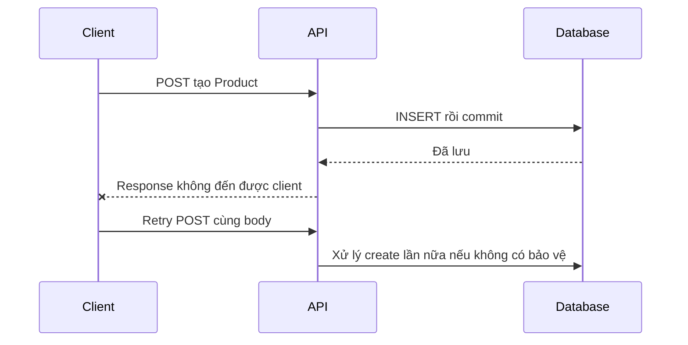

# M3-1 · Lesson 01 — API contract, versioning và retry đúng nghĩa

> Viết lại **2026-11-20** cho cách học của bạn: đã biết Controller/Service/Repository, cần hiểu quyết định API ảnh hưởng client và dữ liệu thế nào. Học khoảng 90–120 phút, có thể chia hai buổi. Đây là bài đọc và suy luận, chưa bắt dựng project mới.

M3-1 có **3 lesson**:
1. Bài này: resource/contract, URL versioning, thay đổi tương thích và idempotency/retry.
2. List API: pagination, filter, sort, metadata và hợp đồng DTO.
3. Lỗi thống nhất: ProblemDetail, ranh giới xử lý lỗi và HATEOAS ở mức nhận diện.

Không học trước JWT/OAuth2, Redis, API Gateway hay pipeline. Phần pagination/error format sâu để đúng lesson sau, không nhồi vào bài này.

## 1. Học xong phải giải thích được gì?

- Client nhìn thấy gì trong một API, ngoài code Java của bạn?
- Đổi DTO/URL/status có thể làm client cũ hỏng ra sao?
- Version v1/v2 liên quan gì tới DB/schema?
- Vì sao retry cùng PUT/DELETE không đồng nghĩa response giống hệt?
- Vì sao timeout không chứng minh server chưa xử lý?
- DTO và annotation đúng có đủ bảo đảm contract đúng không?

**Cần hiểu:** dữ liệu đầu vào/đầu ra, tác động lên state và giả định khi retry.

**Được tra:** syntax annotation, constructor DTO, HTTP status khi chưa nhớ. Không học thuộc đoạn RFC hoặc tên method nội bộ Spring.

## 2. Tài liệu và video liên quan

Đọc theo phần đang học, không cần đọc cả RFC:

- [Spring MVC mapping requests](https://docs.spring.io/spring-framework/reference/web/webmvc/mvc-controller/ann-requestmapping.html): URL ở class + method, HTTP method.
- [RFC 9110: safe](https://www.rfc-editor.org/rfc/rfc9110.html#section-9.2.1) và [idempotent](https://www.rfc-editor.org/rfc/rfc9110.html#section-9.2.2): đối chiếu thuật ngữ sau khi hiểu ví dụ.
- [RFC 9110: PUT](https://www.rfc-editor.org/rfc/rfc9110.html#section-9.3.4), [DELETE](https://www.rfc-editor.org/rfc/rfc9110.html#section-9.3.5): tra nghĩa method.
- [RFC 5789: PATCH](https://www.rfc-editor.org/rfc/rfc5789.html#section-2): chỉ cần phân biệt replacement và sửa một phần.

Video tùy chọn, tìm theo các cụm:
- “REST API contract versioning backward compatibility examples”.
- “HTTP idempotency PUT DELETE retry timeout explained”.
- “Spring Boot REST ResponseEntity Location header”.

Đây là từ khóa tìm, không phải video đã được xem hoặc xác nhận chất lượng. Chọn video có request/response và bảng dữ liệu trước–sau, không chỉ liệt kê annotation.

**Phân biệt nguồn với quy ước:** HTTP có nghĩa method/status; việc shopcore chọn /api/v1, danh từ số nhiều, DELETE đã vắng trả 404 là **quy ước của bài**, không phải mọi hệ thống bắt buộc giống vậy.

## 3. API contract: client không nhìn thấy Entity/Service của bạn

Giả sử frontend gửi:

```http
GET /api/v1/products/10
Accept: application/json
```

Server trả:

```http
HTTP/1.1 200 OK
Content-Type: application/json

{"id":10,"name":"Keyboard","price":120.00,"categoryId":2}
```

Client biết:
- Method GET và URL để gọi.
- Request có cần path/query/body/header nào.
- Response status/header/body.
- Field price là number, đơn vị tiền gì, null được không.
- Hành động này là đọc, tạo, thay hay xóa dữ liệu.

Client **không cần biết** bạn dùng JpaRepository, JOIN FETCH, hay tên ProductServiceImpl.

```text
Client lập request theo contract
-> Controller nhận/bind input
-> Service thực hiện đúng ý nghĩa hành động
-> Repository đọc/ghi theo nhu cầu
-> Service/mapper dựng Response DTO
-> Controller đặt HTTP status/header
-> JSON và status tới client
```

Ý nghĩa: chỉ một tầng làm sai cũng có thể phá contract. DTO đúng field nhưng Service cộng stock thay vì gán stock vẫn sai. Service đúng dữ liệu nhưng Controller trả HTTP 200 cho một response được công bố là lỗi cũng không được sửa bằng thêm status=404 vào JSON.

Ví dụ client cũ:

```javascript
const product = await response.json();
displayPrice(product.price);
```

Nếu backend xóa price và chỉ trả amount, Java vẫn compile nhưng client đọc product.price không còn dữ liệu như trước. **Backend chạy được không đồng nghĩa client còn tương thích.**

## 4. Resource, URL và method

Trong bài:
- Resource: Product hoặc collection Product.
- /api/v1/products: collection.
- /api/v1/products/10: Product cụ thể.
- ?categoryId=2: lọc collection theo Category, không biến thành Product id=2.
- Body JSON: dữ liệu tạo/thay đổi resource.

Quy ước shopcore dùng products/categories, không gắn tên method Java như getAllProducts vào URL. Đây là convention để dễ đoán và thống nhất.

| Việc cần làm | Method + URL |
|---|---|
| List Product | GET /api/v1/products |
| Detail | GET /api/v1/products/10 |
| Tạo mới | POST /api/v1/products |
| Thay các field writable | PUT /api/v1/products/10 |
| Xóa | DELETE /api/v1/products/10 |

Cùng URL /products/10 có thể có GET/PUT/DELETE với ý nghĩa khác nhau. HTTP method là phần của contract, không chỉ nhìn URL.

Một GET không nên bị biến thành thao tác tăng giá/xóa dữ liệu chỉ vì code tiện. Các hệ thống cache/crawler/client có thể gọi GET mà không dự định thay đổi state nghiệp vụ.

## 5. Status, header và body: ba phần khác nhau

### 5.1. Tạo thành công

```http
POST /api/v1/products
Content-Type: application/json

{"sku":"KB-001","name":"Keyboard","price":120.00,"categoryId":2}
```

Giả sử tạo id=11:

```http
HTTP/1.1 201 Created
Location: /api/v1/products/11
Content-Type: application/json

{"id":11,"name":"Keyboard","price":120.00,"categoryId":2}
```

201 nói đã tạo; Location cho client đường tới resource mới; body là representation được công bố. Không để Location trỏ v2 trong khi tạo theo route v1 và client chỉ được hướng dẫn v1.

### 5.2. Quy ước status của bài

| Tình huống | Kết quả |
|---|---|
| Đọc detail thành công | 200 + DTO |
| List hợp lệ nhưng rỗng | 200 + collection/page content rỗng |
| Tạo Product | 201 + Location + DTO |
| PUT Product đang tồn tại | 200 + DTO |
| DELETE thành công | 204, không response body |
| Detail hoặc PUT id không có | 404 theo policy bài |
| Input thiếu/sai theo quy ước validation | 400 |
| Trùng SKU đã được quy định unique | 409 |

List rỗng không có nghĩa collection endpoint không tồn tại. Detail id=999 không có là tình huống khác.

**Lưu ý:** PUT trong HTTP có thể tạo resource trong thiết kế cho phép, với status phù hợp. Shopcore bài này chọn **chỉ update Product tồn tại**, nên PUT id vắng trả 404. Không học nhầm đây là luật “mọi PUT luôn trả 200 hoặc không bao giờ được tạo”.

204 không có content. Không trả 204 kèm JSON “xóa thành công”; chọn một response có body theo contract khác nếu cần body.

### 5.3. Đổi số trong JSON không đổi HTTP status

```http
HTTP/1.1 200 OK
Content-Type: application/json

{"status":201,"message":"created"}
```

Đó vẫn là HTTP 200. Client/proxy/monitor có thể dựa vào status ở HTTP, không đọc số trong JSON theo cách bạn mong muốn.

ResponseEntity điều khiển phần HTTP. ApiResponse là DTO/wrapper trong body nếu dự án chọn dùng; nó không tự thay status header của HTTP. Response DTO vẫn là dữ liệu có thể trả cho client, không phải “chỉ nằm nội bộ backend”.

## 6. URL versioning: /api/v1 nói về cái gì?

V1 là version **hợp đồng API công khai** đã chọn. Nó không phải:
- Java 21.
- Flyway V1/V2.
- Phiên bản app release mỗi lần deploy.
- Phiên bản model AI.

Một app có thể cung cấp cả v1 và v2, dùng chung DB và Service:

```text
Client cũ -> /api/v1/products/10 -> ProductV1Response có price
Client mới -> /api/v2/products/10 -> ProductV2Response có amount
                          cả hai có thể dùng chung domain/service
```

Ở v2 có thể đổi representation, không nhất thiết tạo database khác hoặc copy nghiệp vụ thành hai Service độc lập.

Header/media-type versioning cũng tồn tại. Bài này dùng URL versioning vì dễ nhìn; không bắt triển khai mọi chiến lược.

## 7. Thay đổi nào làm client cũ bị vỡ?

Phải đọc giả định client, không đoán mọi client giống nhau.

| Thay đổi | Vì sao có thể breaking |
|---|---|
| Xóa price, chỉ còn amount | Client đọc price không còn nhận field đó |
| price từ number thành object | Client tính toán number gặp kiểu khác |
| Request mới bắt buộc description | Client cũ không gửi có thể bị từ chối |
| Page đổi từ 0-based thành 1-based | Cùng request nhưng lấy trang khác |
| Đổi ý nghĩa price từ VND sang đơn vị khác mà không báo | Field/kiểu giữ nguyên nhưng nghĩa đã đổi |
| Đổi HTTP status/error shape client phụ thuộc | Nhánh xử lý client có thể không chạy đúng |

Thêm response field optional thường tương thích **với client bỏ qua field lạ**. Client strict có thể từ chối field mới. Không nói “thêm field luôn an toàn”.

Đổi thuật toán bên trong, thêm index hoặc thay repository mà giữ contract và kết quả đúng thường không cần một public v2. API version không phải số tăng theo mọi thay đổi code.

### Kế hoạch chuyển v1 → v2

1. Xác định client đang dùng field/ý nghĩa nào.
2. Định nghĩa response v2 và giữ v1 cho client cũ trong thời gian chuyển.
3. Có thể dùng DTO/mapper theo version, chia sẻ nghiệp vụ phù hợp.
4. Thông báo cách nâng cấp và thời điểm ngừng hỗ trợ; quan sát client còn gọi v1.
5. Chỉ ngừng v1 theo kế hoạch công bố, không đổi tên route rồi xóa ngay.

Bài này không bắt cài telemetry hoặc viết gateway. Chỉ cần biết vì sao phải có bằng chứng client đã chuyển, không tự cho rằng tất cả sẽ cập nhật cùng lúc.

## 8. Safe khác idempotent

**Safe:** client yêu cầu thao tác đọc, không yêu cầu thay đổi state nghiệp vụ. GET nên safe. Log truy cập/metrics có thể vẫn được ghi.

**Idempotent:** gửi lặp cùng request có intended effect lên resource như thực hiện một lần. Không yêu cầu mọi response byte/status/timestamp giống hệt.

| Method trong thiết kế HTTP đúng nghĩa | Safe? | Idempotent? |
|---|---|---|
| GET | Có | Có |
| PUT | Không | Có |
| DELETE | Không | Có |
| POST tạo mới thông thường | Không | Không được bảo đảm |
| PATCH | Không | Tùy ý nghĩa patch, không mặc định |

Cùng request ở đây gồm method, target resource và payload liên quan; không chỉ “JSON giống nhau”. PUT /products/10 và PUT /products/11 tác động hai resource khác nhau.

Các ví dụ retry dưới giả định không có người/job khác thay dữ liệu xen giữa và validation đều hợp lệ. Nếu có tác nhân khác, cần giải quyết cạnh tranh riêng; idempotent không tự ngăn mọi lost update. Không yêu cầu triển khai ETag/locking ở lesson này.

## 9. PUT: thay writable representation, không cộng dồn

### 9.1. Những field nào do client được thay?

Contract ví dụ:
- Cho client thay: name, price, categoryId.
- id lấy từ path.
- createdAt do server quản lý.
- SKU không được đổi qua endpoint PUT này.

Không bắt client gửi lại toàn bộ field Entity/database. DTO request mô tả **phần client được phép thay**.

```http
PUT /api/v1/products/10
Content-Type: application/json

{"name":"Keyboard","price":120.00,"categoryId":2}
```

Nếu body thiếu price, bài này chọn 400 vì PUT yêu cầu đủ ba field writable; không âm thầm coi thiếu là “giữ nguyên”. Bài validation/error sâu nằm lesson khác, nhưng contract phải nói rõ.

### 9.2. Bảng retry gán giá trị

| Trước | Request | Sau lần 1 | Sau lần 2 giống hệt |
|---|---|---|---|
| name=Old, price=100, categoryId=1 | thay thành Keyboard/120/2 | Keyboard/120/2 | Keyboard/120/2 |

Không cần field id/createdAt gửi trong body. Server có thể ghi audit mỗi lần mà intended replacement vẫn như nhau.

### 9.3. Bài stock: gán khác tăng thêm

Tình huống riêng: endpoint PUT /api/v1/products/10/stock công bố body stock là **giá trị mới tuyệt đối**.

```java
// Sai với contract replacement:
product.setStock(product.getStock() + request.getStock());
```

Stock ban đầu 5, body stock=3:
- Lần 1: 8.
- Retry: 11.

Đúng contract là gán stock=request.stock, nên sau một hoặc hai lần đều là 3. Annotation @PutMapping không tự sửa logic cộng dồn trong Service.

Không có quy tắc “cứ dùng PUT thì code nào cũng idempotent”. Method đặt ra semantics; triển khai phải tuân nó.

## 10. DELETE: status khác vẫn có thể idempotent

Theo policy của bài:

```text
Ban đầu: Product 10 có trong DB
DELETE lần 1 -> xóa -> HTTP 204
DELETE lần 2 -> Product không có -> HTTP 404
Sau cả hai: Product 10 không tồn tại
```

Lần hai response khác nhưng intended effect “resource không còn” vẫn giống sau lần đầu. Dự án khác có thể chọn 204 cả khi đã vắng; phải công bố và dùng nhất quán.

Đừng kiểm idempotency bằng việc so response string. Kiểm trạng thái/tác động được yêu cầu.

Audit ghi hai lần không tự phá idempotency. Nhưng thiết kế “mỗi lần retry DELETE đều hoàn tiền thêm 120” tạo side effect nghiệp vụ cộng dồn. Không được dùng việc Product chỉ xóa một lần để bỏ qua nguy cơ hoàn tiền hai lần.

## 11. PATCH: sửa một phần nhưng cần định nghĩa thao tác

Hai tình huống độc lập, ban đầu stock=5, name=Old:

| Patch operation được API công bố | Sau lần 1 | Sau retry giống hệt |
|---|---|---|
| Gán name=Keyboard | Keyboard | Keyboard |
| Tăng stock thêm 3 | stock=8 | stock=11 |

Vì vậy PATCH có thể được thiết kế idempotent, nhưng method PATCH không tự bảo đảm mọi operation lặp an toàn.

Nếu body có field vắng mặt/null, cần quy định:
- Không gửi name là giữ nguyên hay lỗi?
- Gửi name=null là xóa giá trị, giữ nguyên hay lỗi?
- Những field nào được phép sửa?

Không tự suy ra từ DTO class. Không bắt triển khai JSON Patch/Merge Patch hoặc học mọi media type; chỉ hiểu contract cần rõ và không âm thầm coi PUT là partial update.

## 12. Timeout: client chưa biết kết quả, không đồng nghĩa rollback



Ý nghĩa từng bước:
1. Request tới API và nghiệp vụ đã chạy.
2. DB commit nghĩa là dữ liệu đã lưu trong tình huống này.
3. Response mất trên đường đi; client chỉ biết timeout, không được kết luận DB rollback.
4. Retry cùng body có thể tạo thêm resource hoặc gặp constraint tùy thiết kế.
5. Client cần cách xác nhận kết quả thay vì mù quáng coi request đầu chưa xảy ra.

Nếu tạo AI job tốn phí, vấn đề tương tự: timeout chưa chứng minh job/model chưa chạy. Đây là liên hệ ứng dụng, không yêu cầu học queue/model API bây giờ.

## 13. Unique SKU khác cơ chế replay kết quả

Giả sử request đầu đã tạo SKU KB-001, client chưa nhận response.

- Retry cùng SKU gặp unique constraint có thể bị chặn và trả 409.
- Điều đó giúp không có hai Product cùng SKU.
- Nhưng client nhận 409 chưa đồng nghĩa hệ thống tự trả lại đúng response của request đầu.
- SKU là quy tắc duy nhất nghiệp vụ; không tự trở thành ID cho mọi lần gọi hoặc mọi hành động.

Đừng mặc định mọi create đều có một natural key duy nhất thích hợp. Một order/job hợp lệ có thể có cùng payload nhưng là hai ý định khác nhau.

### Idempotency key ở mức nhận diện

Giả sử API công bố quy ước riêng: client gửi key cho **một ý định tạo**; server liên kết key/phạm vi người gọi với request và kết quả.

- Retry cùng ý định: giữ cùng key theo contract, server có thể nhận ra đã xử lý.
- Cùng key nhưng payload khác: cần phát hiện và từ chối theo policy đã công bố, không im lặng coi là cùng request.
- Hai ý định tạo khác nhau: không tái dùng một key chỉ vì JSON giống nhau.
- Thiết kế thật còn phải xử lý race, trạng thái đang chạy, phạm vi key và thời hạn lưu. Một Map hoặc Redis đơn lẻ không tự chứng minh exactly-once cho mọi side effect.

Đây là nhận diện giải pháp, **không yêu cầu triển khai kho key, TTL hoặc thuật toán concurrency**. Không coi tên header hoặc status từ chối một policy là chuẩn bắt buộc cho mọi API.

## 14. Code Spring minh họa đúng contract

Các snippet ở file riêng, dùng Java/class DTO theo style bạn quen; imports và constructor Lombok đã có. Service interface dưới chỉ mô tả hợp đồng cần gọi, chưa phải toàn bộ project chạy được.

```java
@Getter
@Setter
@NoArgsConstructor
public class CreateProductRequest {
    private String sku;
    private String name;
    private BigDecimal price;
    private Long categoryId;
}

@Getter
@Setter
@NoArgsConstructor
public class ReplaceProductRequest {
    private String name;
    private BigDecimal price;
    private Long categoryId;
}

@Getter
@AllArgsConstructor
public class ProductResponse {
    private Long id;
    private String name;
    private BigDecimal price;
    private Long categoryId;
}

public interface ProductService {
    ProductResponse create(CreateProductRequest request);
    ProductResponse replace(Long id, ReplaceProductRequest request);
    void delete(Long id);
}
```

Service implementation thực tế phải kiểm input/business rule; trong ví dụ đọc này coi input đã hợp lệ, thiếu/sai/trùng/không thấy được xử lý theo policy ở mục 5. Không tự coi @RequestBody đã validate giá hoặc tồn tại Category.

```java
@RestController
@RequestMapping("/api/v1/products")
@RequiredArgsConstructor
public class ProductController {
    private final ProductService productService;

    @PostMapping
    public ResponseEntity<ProductResponse> create(
            @RequestBody CreateProductRequest request) {
        ProductResponse created = productService.create(request);
        URI location = URI.create("/api/v1/products/" + created.getId());
        return ResponseEntity.created(location).body(created);
    }

    @PutMapping("/{id}")
    public ResponseEntity<ProductResponse> replace(
            @PathVariable("id") Long id,
            @RequestBody ReplaceProductRequest request) {
        ProductResponse updated = productService.replace(id, request);
        return ResponseEntity.ok(updated);
    }

    @DeleteMapping("/{id}")
    public ResponseEntity<Void> delete(@PathVariable("id") Long id) {
        productService.delete(id);
        return ResponseEntity.noContent().build();
    }
}
```

Đọc theo ý nghĩa, không thuộc code:
- Class-level path + method path tạo URL.
- @PathVariable lấy id từ URL; @RequestBody bind JSON thành DTO.
- Service làm create/replace/delete theo đúng semantics, không phải annotation tự đảm bảo nghiệp vụ.
- ResponseEntity.created thêm HTTP 201/Location; ok trả 200; noContent trả 204 không body.
- Tạo DTO không làm đổi API thành “nội bộ”; ProductResponse là JSON client có thể nhận.

Nếu app dùng ApiResponse<T> để bọc data, hãy công bố JSON thực tế và giữ tương thích. Không dùng số trong wrapper để thay HTTP status. Lesson 03 sẽ xử lý error format thống nhất, chưa bắt đổi common của bạn trong bài này.

## 15. Cách tự kiểm mà không cần dựng project

1. Chọn một request với method/URL/body rõ.
2. Viết state trước khi gửi.
3. Dự đoán state và status/body sau lần đầu.
4. Gửi lại cùng request trong giả định không có cập nhật xen giữa.
5. So tác động lên resource, không chỉ response.
6. Thử một client v1 đang dùng field cũ, xem đổi contract có làm nó hỏng không.

Hai câu tự nói được là đủ nền:
- “Tại sao response DELETE khác nhưng effect vẫn idempotent?”
- “Tại sao POST timeout sau commit vẫn có thể bị trùng khi retry?”

## 16. Những hiểu nhầm cần tránh

| Hiểu nhầm | Chỉnh lại |
|---|---|
| DTO chỉ nằm trong backend | Response DTO là hợp đồng JSON có thể trả cho client |
| Thêm field response luôn không breaking | Cần biết client có chấp nhận field lạ không |
| URL v2 cần database v2 riêng | Version API là contract; DB/service có thể dùng chung |
| @PutMapping tự bảo đảm idempotent | Logic Service phải thực hiện đúng semantics |
| Idempotent nghĩa status/body luôn giống | Xét intended effect, không phải từng byte response |
| Timeout nghĩa server rollback | Client không biết; server có thể đã commit |
| Unique SKU là replay response | Nó chặn trùng SKU, không tự trả lại kết quả đầu |
| PUT phải gửi mọi field Entity | Gửi đủ writable representation theo contract |
| PATCH luôn idempotent | Tùy operation, gán khác cộng dồn |

## 17. Đề kiểm tra và bước tiếp theo

Làm [đề Lesson 01 mới — 16 câu](../../../Exams/de-kiem-tra/M3-1-rest-bp__2026-11-20__lesson1-lan2.md). Bài giải/rubric riêng, mở sau khi làm. Có thể gửi chấm từng nhóm câu như trước; mỗi lần chấm lưu snapshot.

Lesson 02 và 03 giữ nguyên để học sau, chưa được soạn lại trong lượt này. Không tự tick kiến thức hoặc ghi nhận code capstone đã xong khi mới đọc tài liệu.

Bản Lesson 01 trước được giữ ở [file lịch sử](LESSON_01_RESOURCE_VERSIONING_IDEMPOTENCY__TRUOC_2026_11_20.md). Các ví dụ trong bản mới đã được kiểm tĩnh/đối chiếu nguồn, chưa build app hoặc test HTTP thực tế.
