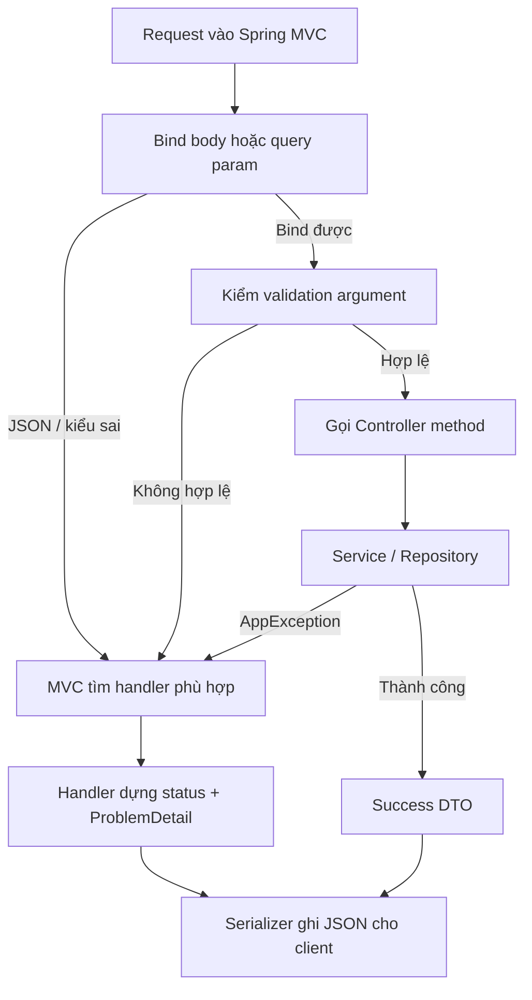

# M3-1 · Lesson 03 — Luồng lỗi, ProblemDetail và nhận diện HATEOAS

> Viết lại 2026-11-21. Lesson cuối của M3-1. Bạn đã đạt Lesson 01/02; bài này nối với **AppException + ErrorCode** bạn đã viết, không bắt dựng lại project. Học khoảng 90–120 phút, có thể chia hai buổi.

**Mục tiêu:** nhìn một lỗi, biết nó xuất hiện trước hay trong Controller/Service; biết cơ chế nào xử lý; thiết kế response lỗi nhất quán và an toàn. HATEOAS chỉ cần nhận diện link có ý nghĩa, không cài thư viện hay triển khai toàn bộ.

## 1. Bắt đầu từ code của chính bạn

Đã đọc source trong shopcore/common ngày 2026-11-21:

- AppException giữ một ErrorCode.
- ErrorCode có code số, message và HttpStatus.
- PRODUCT_NOT_FOUND và CATEGORY_NOT_FOUND đều có code404 nhưng tên khác nhau.
- GlobalExceptionHandler hiện trả ApiErrorResponse gồm code/message, có handler riêng cho business, binding, JSON và validation.

Điều bạn đang làm **không sai chỉ vì chưa dùng ProblemDetail**. API có thể chọn format riêng. Lesson này học cách công bố một format lỗi chuẩn hóa, không phải thay mọi lỗi Java bằng AppException.

Ba thứ khác nhau:

```text
Exception Java: sự cố trong lúc xử lý
Handler: code quyết định chuyển sự cố đó thành response thế nào
ProblemDetail: object mô tả lỗi để gửi cho client
```

Ví dụ: Service ném AppException không có nghĩa client nhận nguyên object exception. Framework tìm handler; handler tạo body và status; serializer mới viết JSON.

## 2. Một contract mẫu cố định, không bắt bạn đoán

Giả định **API v1 đã có client dùng code/message**. Để minh họa thay format có kế hoạch, bài chọn **contract mẫu v2** dưới đây. Không tự tạo endpoint v2 trong source app và không khẳng định mọi đổi format đều bắt buộc chọn URL versioning. Cần xét client và kế hoạch chuyển như Lesson 01.

| Tình huống | HTTP status | code số | errorKey |
|---|---:|---:|---|
| Product không có | 404 | 404 | PRODUCT_NOT_FOUND |
| Category không có | 404 | 404 | CATEGORY_NOT_FOUND |
| SKU trùng | 409 | 409 | DUPLICATE_SKU |
| Body JSON không đọc được | 400 | 400 | INVALID_REQUEST_BODY |
| Param sai kiểu/giá trị | 400 | 400 | INVALID_PARAMETER |
| DTO không đạt validation | 400 | 400 | INVALID_REQUEST |
| Method không được hỗ trợ | 405 | 405 | METHOD_NOT_ALLOWED |
| Lỗi nội bộ bất ngờ | 500 | 9999 | UNCATEGORIZED_EXCEPTION |

Trong bài, client chấp nhận media type của response. Lỗi trả **application/problem+json**, body là ProblemDetail trực tiếp, không bọc vào ApiResponse.data. Success vẫn ProductResponse hoặc PageResponse của Lesson 02, không đổi thành ProblemDetail.

Hai quy tắc riêng:

1. **HTTP status = body.status** trong response mẫu này.
2. **code không bắt buộc bằng status**: lỗi nội bộ có code9999 nhưng HTTP/body.status500. Không dùng code nghiệp vụ làm HTTP status.

## 3. Đọc một response thật rõ từng field

```http
HTTP/1.1 404 Not Found
Content-Type: application/problem+json

{
  "type":"urn:shopcore:problem:product-not-found",
  "title":"Product Not Found",
  "status":404,
  "detail":"Product không tồn tại.",
  "instance":"urn:uuid:11111111-1111-4111-8111-111111111111",
  "code":404,
  "errorKey":"PRODUCT_NOT_FOUND",
  "traceId":"11111111-1111-4111-8111-111111111111"
}
```

| Field chuẩn | Bạn cần hiểu |
|---|---|
| type | URI nhận diện **loại lỗi**, không phải tên class Java |
| title | Tên ngắn của loại lỗi, không phải stack trace |
| status | Mã HTTP cho trường hợp này |
| detail | Giải thích an toàn về lỗi lần này, giúp người gọi hiểu/sửa request |
| instance | URI nhận diện **lần lỗi cụ thể**, không đồng nghĩa URL Product bị thiếu |

code/errorKey/traceId là **extension của dự án**, không phải năm field chuẩn. errors ở mục 8 cũng là extension. RFC không bắt mọi body luôn có đủ năm field; bài chọn xuất đủ để contract dễ kiểm. [RFC9457, mục 3](https://www.rfc-editor.org/rfc/rfc9457.html#section-3).

**Cùng loại, khác lần:** hai request đều không tìm thấy Product có thể dùng cùng type/errorKey nhưng instance khác nhau. urn:uuid chỉ là định danh; không cần có trang web mở được. Client không nên suy ra mỗi instance đều là URL phải gọi GET.

**Instance không phải path:** GET /products/999 lặp hai lần có cùng path nhưng là hai lần xuất hiện lỗi. Có thể lưu path riêng nếu cần và an toàn; đừng dùng path như thể nó luôn định danh duy nhất lần lỗi. Tài liệu Spring7.1 cũng ghi thay đổi không tự gán instance bằng path; bài **set instance tường minh**, không phụ thuộc default của phiên bản. [Spring Error Responses](https://docs.spring.io/spring-framework/reference/web/webmvc/mvc-ann-rest-exceptions.html).

## 4. code, errorKey, message và HTTP status: giữ đúng vai trò

Với enum hiện tại của bạn:

```text
PRODUCT_NOT_FOUND -> code404, HTTP404
CATEGORY_NOT_FOUND -> code404, HTTP404
```

Chỉ nhìn code404 không phân biệt hai business case. Giữ code số để phản ánh ý tưởng cũ, thêm errorKey ổn định để client chọn hành vi. Client cũng có thể dùng type đã công bố.

```text
Nếu errorKey=PRODUCT_NOT_FOUND -> xử lý màn Product
Nếu errorKey=CATEGORY_NOT_FOUND -> xử lý màn Category
```

Không viết logic bằng cách so chuỗi detail=="Product không tồn tại." vì câu chữ/ngôn ngữ có thể đổi. Tuy nhiên errorKey/code cũng phải là contract ổn định, không tùy tiện đổi tên enum rồi coi client tự hiểu.

Giữ code số **không làm cả migration tự tương thích**: v1 client đọc message mà v2 chuyển sang detail/title thì client đó vẫn cần cập nhật. Nếu đổi code từnumber sangstring ngay trên v1 thì còn thay cả kiểu. Không âm thầm thay schema đã có client.

## 5. Luồng thành công và luồng lỗi không đi cùng một đường tới cuối



**Giải thích mũi tên:**

1. MVC phải dựng argument trước khi gọi method. JSON hỏng hoặc pageabc không biến thành số được thì dừng ở bướcbind.
2. Bind được DTO chưa chắc hợp lệ. Ở ví dụ @Valid cho request body, validation không đạt thì Controller method/Service chưa chạy.
3. Chỉ khi input qua các bước đó, Controller mới gọi Service.
4. Service gặp business rule sai thì ném AppException; các lời gọi phía trên bị ngắt và exception được truyền ra MVC. Không có return success bình thường sau dòng throw đó.
5. MVC exception resolver chọn handler phù hợp; handler trả response lỗi, serializer ghi body. Controller không cần tự catch mọi lỗi.

**Advice không phải trạm mà request nào cũng đi qua trước Controller.** @RestControllerAdvice khai báo các method xử lý lỗi dùng chung. Framework gọi handler phù hợp khi resolve exception trong phạm vi của nó. Khi handler AppException tạo ProblemDetail, chính constructor/object ProblemDetail không làm nhiệm vụ bắt lỗi.

Giả định đơn giản của bài: chỉ có một Advice chính, không có Controller-local handler hoặc filter tự gọi resolver. AppException được ném trực tiếp, không bị catch rồi nuốt.

## 6. Ba request, ba điểm dừng khác nhau

### 6.1. JSON bị thiếu dấu đóng

```http
POST /api/v2/products
Content-Type: application/json

{"name":"Pen"
```

Converter không đọc được JSON → lỗi đọc body trước khi gọi Controller method. Policy trả 400/INVALID_REQUEST_BODY. Không kết luận lỗi này do SKU trùng hoặc Service phải kiểm trước.

### 6.2. JSON đúng nhưng name blank

```java
// Giả định validation provider đã được cài và @Valid được áp dụng.
public class CreateProductRequest {
    @NotBlank
    private String name;
    // Có getter/setter hoặc Lombok tương ứng.
}
```

Client gửi {"name":""}. JSON vẫn bind thành DTO được; @Valid argument không đạt → 400/INVALID_REQUEST; Controller method và Service chưa được gọi trong ví dụ này.

Thường gặp MethodArgumentNotValidException cho @Valid@RequestBody. Method-level validation có thể dùng exception khác; không cần học thuộc mọi tên để làm đề. Không giả định chỉ @RequestBody là đủ validation.

### 6.3. Request hợp lệ nhưng SKU đã có

```java
if (repository.existsBySku(request.getSku())) {
    throw new AppException(ErrorCode.DUPLICATE_SKU);
}
// Dòng tạo/lưu Product phía sau không chạy khi nhánh throw được thực hiện.
```

Service đã được gọi; lỗi business → 409/DUPLICATE_SKU. Không bảo mọi duplicate ngoài đời chắc chắn là AppException: DB unique constraint cũng có thể phát hiện race; bài chỉ xét nhánh throw đã cho, không dạy xử lý race ở đây.

Ghi nhớ ngắn: **đọc không được → kiểm DTO không đạt → business không cho phép** là ba loại khác nhau, dù hai loại đầu đều 400.

## 7. Code mẫu: nối với common của bạn, không sửa app thật

Đây là mẫu **thay thế khi migration có kế hoạch**, không thêm Advice trùng chạy song song với GlobalExceptionHandler cũ. Mẫu dùng API của Spring 6+/7; imports đã ghi để bạn nhìn rõ kiểu. Không cần nhớ signature để làm đề.

```java
package com.shopcore.common;

import java.net.URI;
import java.util.Locale;
import java.util.UUID;
import org.springframework.http.HttpHeaders;
import org.springframework.http.HttpStatusCode;
import org.springframework.http.MediaType;
import org.springframework.http.ProblemDetail;
import org.springframework.http.ResponseEntity;
import org.springframework.http.converter.HttpMessageNotReadableException;
import org.springframework.web.bind.annotation.ExceptionHandler;
import org.springframework.web.bind.annotation.RestControllerAdvice;
import org.springframework.web.context.request.WebRequest;
import org.springframework.web.servlet.mvc.method.annotation.ResponseEntityExceptionHandler;

@RestControllerAdvice
public class GlobalExceptionHandler extends ResponseEntityExceptionHandler {

    @ExceptionHandler(AppException.class)
    public ResponseEntity<ProblemDetail> handleApp(AppException ex) {
        ErrorCode error = ex.getErrorCode();
        ProblemDetail body = problem(error.getHttpStatus(),
                error.name(), error.getMessage(),
                error.getMessage(), error.getCode());
        return ResponseEntity.status(error.getHttpStatus())
                .contentType(MediaType.APPLICATION_PROBLEM_JSON)
                .body(body);
    }

    @Override
    protected ResponseEntity<Object> handleHttpMessageNotReadable(
            HttpMessageNotReadableException ex, HttpHeaders headers,
            HttpStatusCode status, WebRequest request) {
        ProblemDetail body = problem(status, "INVALID_REQUEST_BODY",
                "Invalid Request Body", "Không đọc được JSON body.", 400);
        return ResponseEntity.status(status).headers(headers)
                .contentType(MediaType.APPLICATION_PROBLEM_JSON)
                .body(body);
    }

    private ProblemDetail problem(HttpStatusCode status, String key,
            String title, String safeDetail, int code) {
        ProblemDetail body = ProblemDetail.forStatusAndDetail(status, safeDetail);
        body.setType(URI.create("urn:shopcore:problem:"
                + key.toLowerCase(Locale.ROOT).replace('_', '-')));
        body.setTitle(title);
        String occurrenceId = UUID.randomUUID().toString();
        body.setInstance(URI.create("urn:uuid:" + occurrenceId));
        body.setProperty("code", code);
        body.setProperty("errorKey", key);
        body.setProperty("traceId", occurrenceId);
        return body;
    }
}
```

Đọc từng đoạn, đừng chỉ chép:

1. handleApp lấy ErrorCode: enum vẫn là nơi giữ metadata business, không bắt bỏ kiến trúc bạn quen.
2. forStatusAndDetail dựng object. Nó chưa gửi request hoặc tự gọi Service.
3. setType/setTitle/setInstance điền loại/tên/lần lỗi. UUID là ví dụ ID tương quan, không phải hệ thống distributed tracing đã hoàn chỉnh.
4. setProperty thêm extension. Với JSON support tương ứng của Spring, properties được xuất thành field top-level; không phải body bắt buộc có object properties bọc bên ngoài. [ProblemDetail API](https://docs.spring.io/spring-framework/docs/current/javadoc-api/org/springframework/http/ProblemDetail.html).
5. ResponseEntity quyết định HTTP status/header. Trả cùng status đã dùng trong body.
6. Override nhánh JSON để trả thông báo an toàn, không ex.getMessage() chứa raw body. Giữ status/headers framework truyền vào thay vì đổi tất cả thành 500.

**Giới hạn của mẫu:** mới minh họa business và JSON. Superclass có xử lý nhiều lỗi MVC, nhưng muốn tất cả nhánh đều có extension/errorKey/errors đúng policy riêng, phải tùy biến/kiểm tiếp validation, type mismatch, 405, 500. Không tuyên bố một snippet này hoàn thành toàn bộ contract. App đang khai báo Boot 4.1.1/Java 21; lượt học này không nâng pom, không cài validation provider và không thay Java source.

Nếu dùng superclass đã xử lý built-in exception, tùy biến bằng protected override phù hợp; không thêm @ExceptionHandler trùng exception của superclass một cách tùy tiện. Tra signature đúng version. Cấu hình Boot tự hỗ trợ ProblemDetail cho built-in lỗi cũng không tự ánh xạ business AppException theo enum của bạn. [ResponseEntityExceptionHandler API](https://docs.spring.io/spring-framework/docs/current/javadoc-api/org/springframework/web/servlet/mvc/method/annotation/ResponseEntityExceptionHandler.html).

## 8. Validation errors: client cần biết field nào sai

```json
{
  "type":"urn:shopcore:problem:invalid-request",
  "title":"Invalid Request",
  "status":400,
  "detail":"Có trường không hợp lệ.",
  "instance":"urn:uuid:22222222-2222-4222-8222-222222222222",
  "code":400,
  "errorKey":"INVALID_REQUEST",
  "traceId":"22222222-2222-4222-8222-222222222222",
  "errors":[{"field":"name","message":"Không được để trống."}]
}
```

errors là danh sách theo contract dự án để frontend gắn thông báo vào ô name. Không cần đưa rejectedValue, raw DTO, password hoặc token vào lỗi. Những field không biết không nên làm client ProblemDetail tương thích bị hỏng; extension là phần có thể mở rộng theo contract.

Không cần viết một validation engine riêng. Bạn cần hiểu dữ liệu lỗi được chuyển từ kết quả validation thành danh sách field/message, còn body vẫn là ProblemDetail. Không nhét DTO request nguyên vẹn vào detail để “debug dễ”.

## 9. 500 an toàn và catch-all không được phá lỗi đã có nghĩa

Handler Exception rộng không có nghĩa mọi lỗi đều là 500. Ví dụ endpoint chỉ GET, client POST → framework có thể báo 405 với header Allow:GET. Catch-all trả 500 sẽ làm client tưởng server hỏng, mất thông tin method được hỗ trợ.

Một thứ tự thiết kế hợp lý trong ví dụ đơn giản: xử lý các lỗi MVC đã có status/header → xử lý business đúng ErrorCode → fallback 500 cho lỗi thật sự chưa biết. Đây là thứ tự ưu tiên ý nghĩa; không phải cứ xếp method ở trên file Java thì Spring chọn trước. Cơ chế chọn handler phụ thuộc loại exception, handler được khai báo và cấu hình Advice. [Spring ExceptionHandler](https://docs.spring.io/spring-framework/reference/web/webmvc/mvc-controller/ann-exceptionhandler.html).

Với NullPointerException bất ngờ:

- HTTP/body.status 500, code 9999 theo bảng.
- Detail an toàn kiểu “Không xử lý được yêu cầu lúc này.”
- Log nội bộ stack trace gắn cùng traceId/instance để điều tra; hạn chế truy cập log và không log secret thô.
- Client nhận ID tương quan, không nhận stack trace/SQL/credential. ID phải được gắn với log thực sự mới giúp tra cứu; chỉ random UUID vào JSON chưa tự tạo hệ thống observability.

## 10. Ranh giới Advice: không phải lưới bắt mọi lỗi trên server

| Tình huống | Vì sao/cơ chế cần hiểu |
|---|---|
| JSON/type/validation trong MVC | Resolver/Advice phù hợp có thể xử lý |
| AppException từ Service truyền qua Controller | Handler business trong MVC có thể xử lý |
| Filter ném lỗi trước DispatcherServlet | Không tự đi vào luồng resolver của MVC; cần cơ chế ở filter/container hoặc tích hợp tường minh |
| Startup kết nối DB thất bại | App chưa ready; không có request business để Advice trả lỗi |
| Lỗi authentication/authorization | Có cơ chế Security riêng; học sau ở M3-2 |
| Response đã commit rồi mới ghi JSON/network lỗi | Không bảo đảm thay được status/body bằng ProblemDetail mới |

Ví dụ filter tự throw không gọi resolver không tự được Advice bắt. Không khẳng định mọi app không thể tích hợp filter với resolver: có thể làm tường minh, nhưng **không phải tự động**.

Response commit nghĩa là status/header hoặc một phần body đã gửi; không thể hứa quay lại xóa response đã gửi rồi viết 500 đẹp. Bài chỉ yêu cầu biết giới hạn, không triển khai async/Security/network handling.

## 11. HATEOAS: biết nhìn link và relation, chưa cần viết thư viện

Một response minh họa kiểu HAL:

```json
{
  "id":10,
  "name":"Keyboard",
  "_links":{
    "self":{"href":"/api/v2/products/10"},
    "category":{"href":"/api/v2/categories/2"}
  }
}
```

self chỉ link tới resource hiện tại; category chỉ relation tới Category liên quan; href là địa chỉ. Client hiểu relation category có thể theo link để lấy Category, thay vì tự nối mọi path từ ID. Đây là dấu hiệu sử dụng hypermedia trong representation, không phải toàn bộ tiêu chuẩn để chứng minh một API đã hoàn chỉnh HATEOAS. [Spring HATEOAS, fundamentals](https://docs.spring.io/spring-hateoas/docs/current/reference/html/#fundamentals).

Phân biệt:

- Có /api/v2 nhưng không link: versioning không tự là HATEOAS.
- Có page/size/total: metadata phân trang không tự là HATEOAS.
- Một field url tùy ý chưa nói rõ relation/ý nghĩa cũng chưa đủ để hiểu cách điều hướng.
- HATEOAS không bắt buộc phải dùng Spring HATEOAS hoặc HAL. HAL là một cách biểu diễn; bài chỉ đọc ví dụ, không cài thư viện.

## 12. Thiết kế kiểm tra: request cụ thể, kỳ vọng cụ thể

Không viết chung “test lỗi đầy đủ”. Ví dụ testcase:

```text
Request: GET /api/v2/products/999
Giả định: Product999 không có; Service ném PRODUCT_NOT_FOUND
Kỳ vọng:
- HTTP404; Content-Type application/problem+json
- body.status404; errorKey PRODUCT_NOT_FOUND; code404
- type nhận diện product-not-found; instance riêng cho lần này
- không có stacktrace/password; không bọc data
```

Chạy lại testcase, type/errorKey có thể giữ nguyên nhưng instance/traceId có thể đổi. Không bắt UUID cố định trong integration test. Với validation, kiểm errors có field/message phù hợp; với 405, kiểm giữ header Allow; với unexpected 500, kiểm detail an toàn. Success vẫn DTO 200/201 theo contract, không thành ProblemDetail.

Backend cho AI về sau cũng cần phân biệt input sai/business rule/lỗi nội bộ và không lộ prompt/token/credential trong response. Không thêm kiến thức ML vào đề này.

## 13. Tài liệu và cách học

Đọc theo thứ tự: mục 1–6 để hiểu luồng; mục 7–10 để hiểu handler và giới hạn; mục 11 chỉ nhận diện; mục 12 để biết một testcase cần gì.

- RFC9457: đọc thành viên problem và security, không học thuộc câu chữ.
- Spring Error Responses: ProblemDetail/built-in error support; API page dùng khi quên signature.
- Spring ExceptionHandler: hiểu chọn handler, không làm bài toán thứ tự nhiều Advice ở lesson này.
- Spring HATEOAS: links/relations, không cần affordances/full HAL-FORMS.
- Video tùy chọn: tìm `Spring ProblemDetail RFC 9457 ResponseEntityExceptionHandler` và `HATEOAS HAL self link relation explained`. Đây là từ khóa tìm, chưa xem/xác minh một video cụ thể.

[Làm đề mới Lesson 03: 12 câu/60đ](../../../Exams/de-kiem-tra/M3-1-rest-bp__2026-11-21__lesson3-lan2.md), đạt 51/60. Đề có code/contract đủ để trả lời từng ý; không bắt dự án hoặc tên exception/import chính xác. Không thêm SecurityConfig, câu lệnh OpenAPI hay tracing platform vào rubric.

Soạn bài không tự tick roadmap hoặc cho điểm. Hoàn thành ba lesson không tự có nghĩa deliverable shopcore đã được merge; tiến độ cần ghi đúng bằng chứng học và thực hành.
